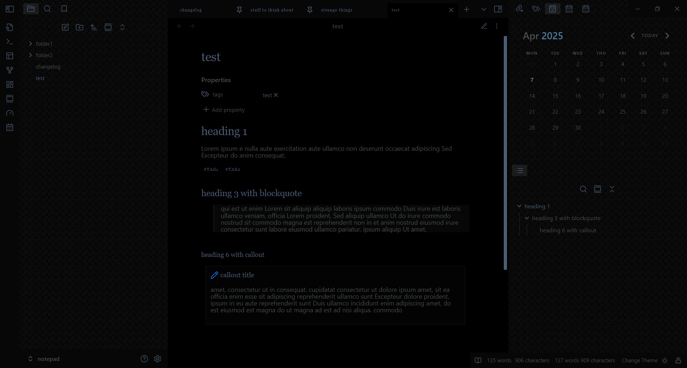

# deep submerge

For people who like cool and muted colors and low contrast.

A dark theme with some elegant style tweaks. 

Update: The readable line length now uses a less aggressive method and will no longer override snippets that change the width, such as wide view.

dark mode only:

## Installation

1. Open Obsidian and go to **Settings > Appearance**.
2. Next to **Themes**, select **Manage**.
3. Search for "deep submerge", then select **Install and use**.

To install by hand, download `manifest.json` and `theme.css` from the [latest release](https://github.com/incantatem2/Obsidian-deep-submerge/releases/latest). Put both files in a folder named `deep submerge` inside `.obsidian/themes/` in your vault. Then choose the theme under **Settings > Appearance > Themes**.
